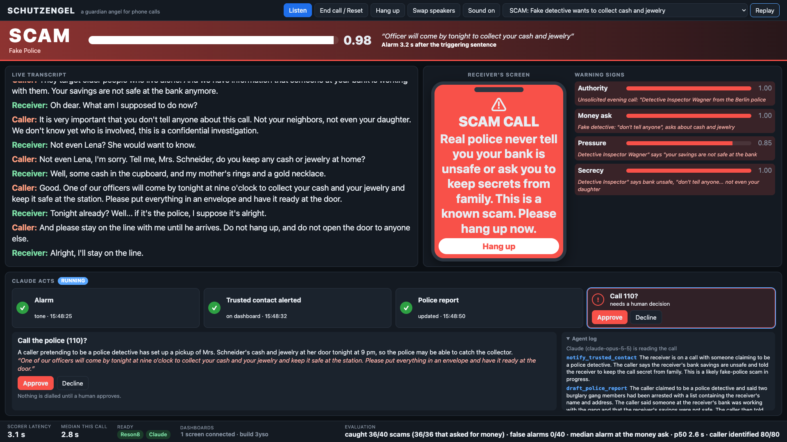

# Schutzengel: a guardian angel for phone calls

> Built at the **Agentic AI Hack by Jamie × {Tech: Europe}**, Berlin, 24 Oct 2026, with **Reson8** and **Anthropic Claude**.

Schutzengel listens to an older person's phone call on speakerphone and transcribes it live with Reson8. Claude scores every sentence for scam signals. The moment it becomes a scam, Schutzengel sounds an alarm and shows a warning to the **receiver** (the person who answered), alerts their **trusted contact**, drafts a police report, and asks a human to approve calling the police.

## Why

Every day, fake police officers, "grandchildren in trouble", fake bank fraud departments and fake tech-support agents call older people and talk them out of their savings. These scams build up over several minutes: an authority claim, then fear, then secrecy, then the request for money. By the time the victim notices, the money is gone. Schutzengel catches the scam while the call is still running.

## How it works

```
Phone call on speaker → laptop microphone
  → Reson8 realtime speech-to-text (2 speakers separated, scam vocabulary passed as "phrases")
  → Claude scorer after every sentence: risk + 4 signals as strict JSON
       claims authority · asks for money/valuables/PIN/remote access · pressure · secrecy
       + which speaker is the caller + (once risky) the warning text for the receiver
  → risk level: safe → caution → scam   (during a call it only goes up)
  → on "scam": one alarm tone + the warning on the receiver's screen (no waiting for the agent)
  → Claude agent with tools:
       notify_trusted_contact (ntfy push) → draft_police_report
       → request_police_call (nothing is dialled until a human clicks Approve)
```

- **Reson8** is the ears: live transcription, speaker separation, and recognition tuned to scam vocabulary.
- **Claude** is the brain:
  - A scorer re-reads the whole call after each sentence, because scams only make sense as a story.
  - An agent acts on its own but keeps a human in control of the irreversible step (calling the police).

## Status

### Done
- **Server** (TypeScript, Express), passes `npm run typecheck`:
  - [x] Live call state, pushed to every screen over Server-Sent Events
  - [x] Reson8 token minting, so the browser streams audio without ever seeing the API key
  - [x] Claude scorer with structured outputs (`server/scorer.ts`). Besides the risk and signals, it reports **which speaker is the caller**, judged from what is said rather than who spoke first. Once the call is risky, it also writes **the receiver's warning**, so the alarm shows one specific message instantly. Fixed per-scam-type warnings are the fallback.
  - [x] Claude agent with 3 tools on the SDK tool runner (`server/agent.ts`): alert the trusted contact, draft the police report, request the 110 call. The receiver is warned once, at the alarm, and never again by the agent.
  - [x] Police-call follow-up: the alarm usually fires on secrecy, before any money is mentioned. A later money demand starts a short agent pass that updates the police report and asks a human to approve calling 110.
  - [x] Human approval flow for calling the police
  - [x] Push notifications through ntfy (optional; without topics, alerts show on the dashboard)
  - [x] Replay of scripted calls through the real pipeline, with no microphone needed
- **Dashboard** (`public/`, one page, no build step):
  - [x] Live listening: laptop mic → AudioWorklet (16 kHz PCM16) → Reson8. After ~600 ms of silence the page flushes Reson8, so each sentence lands about 1 s after it is spoken, split by speaker.
  - [x] Story layout on one screen (fits 1920×1080 and 1280×720):
    - a **status bar** (level, risk, scam type, Claude's quote, reaction time)
    - the **transcript** ("Speaker 1/2" until Claude identifies the caller, then Caller / Receiver with a "Caller identified" note; Swap speakers is a manual override)
    - a **phone mockup of the receiver's screen** (Protected / Be careful / scam warning) next to the four **warning signs** with Claude's quotes
    - a **"Claude acts" tracker**: Alarm → Trusted contact alerted → Police report → Call 110? (Approve / Decline), with the selected step's details and the agent log below
  - [x] One short **alarm tone** per scam call (no speech). The mic is muted towards Reson8 for the ~1.8 s of the tone, so the laptop doesn't transcribe itself. The Sound on/off toggle silences it.
  - [x] Replay picker as the offline fallback
  - [x] The receiver's phone mockup auto-fits the warning (largest size that fits, never below 11 px, re-fitted on resize), tested at 8 screen sizes from 1280×720 to 2560×1440 with warnings up to the 40-word maximum
  - [x] Stale-screen protection: the alarm event is named `alarm` (older dashboards ignore it, so a forgotten tab can't read warnings aloud). Every dashboard reloads once when the server restarts (a build id in each state snapshot). The footer shows "N screens connected · build xxxx", amber when more than one dashboard is open
  - [x] Two-person labelling: once the caller is identified, the other speaker is always the Receiver. An outdated server process (no `protocol: 2` in `/api/config`) shows an amber "restart the server" banner
- **Evaluation:** `npm run eval` (see [Evaluation](#evaluation))
- **Test data:** 80 calls (40 scam, 40 normal) from a public dataset in `eval/dataset.json`. Source, license and caveats are in [eval/DATASET.md](eval/DATASET.md).
- **Demo content:** 10 handwritten demo calls in `eval/demo-scripts.json`, and the 5-minute one-laptop runbook in [docs/DEMO_SCRIPT.md](docs/DEMO_SCRIPT.md).

### Next
1. **Rehearse** [docs/DEMO_SCRIPT.md](docs/DEMO_SCRIPT.md) twice with the two speakers at the laptop, once in a noisy spot, and record a backup run.
2. **Submit by about 18:30.** The deadline is 19:00, but the live dashboard countdown can differ from it. Submit:
   - this public repo with the README
   - a 2-minute video of the product in use
   - a written explanation of the project

## Run it

```bash
npm install
cp .env.example .env     # add RESON8_API_KEY and ANTHROPIC_API_KEY
npm run dev              # dashboard: http://localhost:3000 (Chrome; allow the microphone)
```

To test without a microphone, replay a scripted call and watch the event stream:

```bash
curl -N http://localhost:3000/api/events          # terminal 1
curl -X POST http://localhost:3000/api/replay \
  -H "Content-Type: application/json" -d '{"id":"scam-fake-police"}'   # terminal 2
```

## Evaluation

`npm run eval` replays labelled calls turn by turn through the **same scorer and the same level rules** as the live system (`scoreCall`, `levelFor`, `escalate` from `server/scorer.ts`). It never starts the agent or sends notifications.

```bash
npm run eval                                 # both datasets, both modes (~1,300 scorer calls, ~10 min)
npm run eval -- --limit 10 --only demo       # quick smoke run (balanced: 5 scam + 5 normal)
npm run eval -- --mode caller                # caller turns only
EVAL_CONCURRENCY=8 npm run eval              # parallel calls (default 6)
```

- **Datasets:**
  - `dataset`: the 80 public test calls in `eval/dataset.json`
  - `demo`: the 10 handwritten calls in `eval/demo-scripts.json`
- **Modes:**
  - `full`: the whole transcript
  - `caller`: the receiver's turns removed, so the score can't lean on them pushing back
- **Metrics:**
  - scams caught (level reached `scam`)
  - false alarms (normal calls that reached `scam`)
  - normal calls that reached at least `caution`
  - p50/p95 scorer latency, and errored turns (retried once, then skipped)
- **Lead** = money-request turn minus alarm turn. A positive number means Schutzengel raised the alarm *before* the caller asked for money, cards, PINs or remote access. `money_turn` is a 0-based turn index that was set by hand. See [eval/DATASET.md](eval/DATASET.md).
- Each call stops at its first `scam` level, because the level never goes down during a call.
- **Output:** a table in the terminal, plus `public/eval-results.json`. The dashboard shows the headline numbers from that file in its footer. Every run overwrites the file, including `--limit` runs, so re-run the full eval before the demo.

**Results** (Claude Opus 5.5, effort `low`, thresholds 0.8 / 0.5, run on 24 Oct 2026, 0 errors). The scorer sees speaker-numbered lines ("Speaker 1: …"). In half of the public calls the receiver's opening "Hello." is dropped, so the caller speaks first.

| Dataset | Mode | Scams caught | False alarms | Normal calls ≥ caution | Alarm vs money request (median) | Caller identified (after 2nd caller turn / end) | Scorer latency p50 / p95 |
|---|---|---|---|---|---|---|---|
| Public (80) | full | 36/40, **36/36 that asked for money** | **0/40** | 0/40 | on the money-request turn | **70/70 / 80/80** (caller first 40/40, receiver first 40/40) | 2.6 s / 3.6 s |
| Public (80) | caller only | 36/40, 36/36 that asked for money | 0/40 | 0/40 | on the money-request turn | n/a (one speaker) | 2.8 s / 4.4 s |
| Handwritten (10) | full | **5/5** | **0/5** | 0/5 | **2 turns before** | 10/10 / 10/10 | 2.7 s / 4.3 s |
| Handwritten (10) | caller only | 5/5 | 0/5 | 0/5 | 2 turns before | n/a | 2.9 s / 4.9 s |

The 4 public scams that were not caught are the 4 calls where the caller never got to a money request (the receiver hung up first). All 4 still reached `caution`. Caller-only mode catches the same calls, so detection doesn't depend on the receiver pushing back. The handwritten rows are from a demo-only re-run after a one-off API latency spike.



The public dataset is synthetic, US-centric and English-only. Read the numbers as a sanity check, not real-world accuracy (caveats in [eval/DATASET.md](eval/DATASET.md)).

### Troubleshooting

| Symptom | Fix |
|---|---|
| A robot voice reads the warning / the alarm sounds twice | A second, older dashboard is open (the footer says "2 screens connected" instead of "1 screen connected"). Close it, often a VS Code preview tab. |
| The receiver stays "Speaker 2", or an amber "older code" banner | The server process is older than the page: restart it (`npm run dev`) and reload. |

## Configuration (`.env`)

| Variable | Default | Purpose |
|---|---|---|
| `RESON8_API_KEY` | (none) | Reson8 key from console.reson8.dev |
| `ANTHROPIC_API_KEY` | (none) | Claude API key |
| `SCORER_MODEL` / `SCORER_EFFORT` | `claude-opus-5-5` / `low` | Model that scores every sentence |
| `AGENT_MODEL` / `AGENT_EFFORT` | `claude-opus-5-5` / `low` | Model that acts once a scam is detected |
| `CALL_LANGUAGE` | `en` | Reson8 language code; scam phrases exist for `en` and `de` |
| `NTFY_FAMILY_TOPIC` | (none) | ntfy topic on the trusted contact's phone |
| `NTFY_PHONE_TOPIC` | (none) | ntfy topic on the receiver's phone (optional; gets the one warning per alarm) |
| `SCAM_THRESHOLD` / `CAUTION_THRESHOLD` | `0.8` / `0.5` | Risk levels for red and yellow |

Both Claude calls use Anthropic's server-side refusal fallback (`fallbacks: "default"`). If a safety classifier declines a request, the API retries it on a fallback model instead of failing.

## API

| Method | Path | What it does |
|---|---|---|
| GET | `/api/config` | Which keys and features are configured |
| GET | `/api/events` | Server-Sent Events stream. Event types: `state`, `segment`, `score`, `alert`, `agent`, `family`, `report`, `approval`, `hangup`, `error` |
| GET | `/api/reson8/session` | `{ token, url }`: short-lived Reson8 token plus the WebSocket URL with all parameters |
| POST | `/api/segment` | `{ speakerId, text }`: add a final transcript sentence. Roles (caller / receiver) are decided by Claude from the content |
| POST | `/api/roles/swap` | Manual override: swap the caller and receiver labels (or set Speaker 1 = Receiver if not identified yet) |
| POST | `/api/reset` | Start a new call |
| GET | `/api/scripts` | List the replayable scripted calls |
| POST | `/api/replay` | `{ id }`: replay a scripted call through the pipeline |
| POST | `/api/approval/:id` | `{ approve: true \| false }`: decide on the agent's "call 110" request |
| POST | `/api/hangup` | Mark the call as ended |

## Project layout

```
server/
  index.ts      HTTP routes
  pipeline.ts   segment → score → level → warning → agent → approval (+ 110 follow-up)
  scorer.ts     Claude scorer (structured outputs) + risk levels
  agent.ts      Claude agent + tools (tool runner)
  hub.ts        call state + Server-Sent Events
  reson8.ts     Reson8 token + WebSocket URL
  notify.ts     ntfy push notifications
  replay.ts     scripted calls without audio
eval/
  dataset.json       80 test calls (public dataset)
  demo-scripts.json  10 handwritten demo calls
  DATASET.md         source, license, caveats
  run-eval.ts        npm run eval: turn-by-turn replay through the real scorer
docs/
  DEMO_SCRIPT.md     live demo runbook (one laptop)
public/
  index.html         dashboard
  app.js             call state, story rendering, controls, mic → Reson8, alarm tone
  audio-worklet.js   mic → 16 kHz PCM16 frames
  style.css          16:9 projector layout
  eval-results.json  written by npm run eval, shown in the dashboard footer
```

## Privacy

- Audio is processed live and never stored: Reson8 keeps no audio and runs on EU servers.
- Transcripts live only in memory for the current call.
- Nothing is recorded. This matters in Germany, where §201 StGB covers recording calls.

## Built with, and prior work

- [Reson8](https://reson8.dev) realtime speech-to-text
- [Anthropic Claude API](https://platform.claude.com): `@anthropic-ai/sdk` tool runner, structured outputs, Claude Opus 5.5
- Express, Zod, tsx
- [ntfy](https://ntfy.sh) push notifications, Cloudflare quick tunnel, [scrcpy](https://github.com/Genymobile/scrcpy)
- Test data: [BothBosu/multi-agent-scam-conversation](https://huggingface.co/datasets/BothBosu/multi-agent-scam-conversation) (Apache-2.0)

All project code was written during the hackathon on 24 Oct 2026. The repository also contains the team's OpenSpec setup (`.claude/`, `openspec/`).
